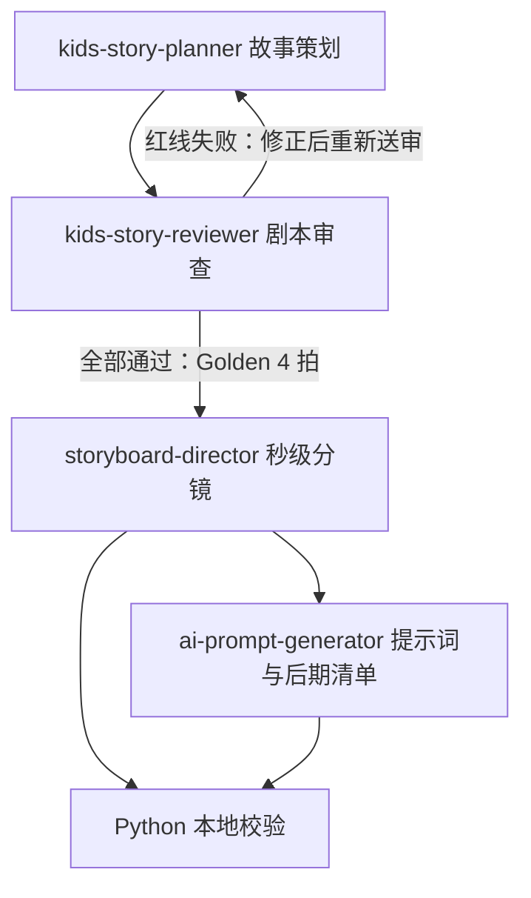

# 叙事工坊

面向 2–6 岁儿童双语英语启蒙短视频的 Codex 插件，将教学词汇逐步转化为故事策划、审查后的四拍大纲、秒级分镜，以及 AI 提示词与后期制作清单。

插件名为 `narrative-studio`，本地市场名为 `ai-creation-studio`，当前清单版本为 `0.2.0-draft`。当前实现已完成验证，仓库保留样稿、反例和回归测试，便于复核。

## 功能与工作流

| Skill | 输入 | 输出 |
| --- | --- | --- |
| [kids-story-planner · 故事策划师](plugins/narrative-studio/skills/kids-story-planner/SKILL.md) | 教学词汇，可选角色、平台和节奏模式 | 规格设定、选定戏剧母题、教学与 TPR 映射、剧情节拍大纲、家长 CTA，共五栏 |
| [kids-story-reviewer · 剧本医生](plugins/narrative-studio/skills/kids-story-reviewer/SKILL.md) | planner 的完整五栏策划稿 | 红线体检、手术级打磨建议，以及通过门禁后生成的 Golden 4 拍润色稿，共三栏 |
| [storyboard-director · 分镜导演](plugins/narrative-studio/skills/storyboard-director/SKILL.md) | reviewer 完整且严格通过的输出 | 导演总览、8 列秒级视听分镜表、首尾循环验证，共三栏 |
| [ai-prompt-generator · 提示词编译器](plugins/narrative-studio/skills/ai-prompt-generator/SKILL.md) | director 的完整输出 | 全局一致性资产卡、逐镜 T2I/I2V 制作矩阵、6 列后期音画装配清单，共三栏 |



四个技能分别手动调用，交接时保留完整上游 Markdown。在同一对话中可沿用上下文；切换对话时需粘贴完整上游输出。所有技能只交付文字，不自动调用其他技能或外部绘图、视频模型 API；图片、视频生成及剪辑由后续制作环节执行。

## 安装与环境支持

### OpenAI Codex

使用支持插件的 Codex，并确保终端可执行 `codex`。在仓库根目录执行：

```bash
codex plugin marketplace add .
codex plugin add narrative-studio --marketplace ai-creation-studio
```

本地市场由 [.agents/plugins/marketplace.json](.agents/plugins/marketplace.json) 定义，插件清单位于 [plugin.json](plugins/narrative-studio/.codex-plugin/plugin.json)，四个技能通过 `"skills": "./skills/"` 入口发现。本地市场与项目启用机制可参考 [OpenAI 官方插件文档](https://developers.openai.com/plugins/build/plugins#enable-or-disable-a-plugin-for-a-repo)。

### Google Antigravity / Gemini

本项目原生支持 Google Antigravity，无需手动注册插件市场：

- 技能发现：通过 [.agents/skills.json](.agents/skills.json) 声明技能检索路径，自动注册 4 个专业技能，随工作区开箱即用。
- 规则与自主校验：项目根目录配置了通用的 [AGENTS.md](AGENTS.md)，指导 Agent 遵循四阶段流水线规范，并在生成分镜与提示词时自动运行 Python 校验器闭环修复，确保格式与时间轴零瑕疵。

安装并加载后，在新对话中按下面的顺序使用。仅运行本地校验脚本和回归测试时，需要 Python 3，无第三方包依赖。

## 使用示例

### 1. 策划故事

```text
$kids-story-planner
teaching_words: Jump
characters: 小恐龙 Pip、小柴犬 Toby
target_platform: YouTube Shorts
pacing_mode: auto
```

也可以直接用自然语言描述需求。策划师支持以下参数：

| 参数 | 必需 | 默认与取值 |
| --- | --- | --- |
| `teaching_words` | 是 | 一个英文词或一组核心对比词，如 `Jump`、`Hot / Cold`；每次聚焦一个教学概念 |
| `characters` | 否 | 默认 Pip 与 Toby；可指定一至两个角色 |
| `target_platform` | 否 | 默认通用；支持 Douyin、TikTok、YouTube Shorts |
| `pacing_mode` | 否 | 默认 `auto`；可选 `rapid`、`standard` |

策划师从八大反差戏剧母题中选择一个主母题。`rapid` 为 10–15 秒、两拍；`standard` 为 15–25 秒、三至四拍；`auto` 根据故事选择实际模式。策划说明用中文，成片以英文原声为主，TPR 提供安全的动作、指认或手势跟做方式，家长 CTA 属于发布文案。

### 2. 审查并润色

```text
$kids-story-reviewer
以下是 kids-story-planner 的完整输出：
[粘贴规格设定、选定戏剧母题、教学与 TPR 映射、剧情节拍大纲及家长 CTA]
```

reviewer 检查四条红线，并从道具玩具化、橡皮泥身体喜剧、教学无歧义、四拍递进因果四个维度提出修正建议：

| 红线错误码 | 拦截的问题 |
| --- | --- |
| `VOCAB_GROUNDING_MISMATCH` | 核心词与当下可观察的动作、状态或空间关系不对应 |
| `UNCLOSED_AIRBORNE_ACTION` | 同一拍未完成起飞、落地及缓冲，把角色留在空中 |
| `TEACHING_POLLUTION_AT_END` | 复位阶段新增教学词、花字或教学事件 |
| `MAGIC_RESET` | 用瞬移、倒放或无因果恢复代替物理复位 |

通过时，体检栏第一条非空正文行必须整行精确为：

```markdown
- **红线筛查**：全部通过
```

通过稿的第三栏包含五个与 planner 同名的三级栏目，并将初稿统一为连续四拍：**首钩示范 → 反向加码 → 失控破功 → 物理回弹复位**。原有教学目标、资产、实际节奏模式和总时长保持一致；四拍不等于四镜，极速版润色后也为四拍。

红线失败时，reviewer 输出错误码、定位和修复建议，第三栏拒绝生成下游大纲。将报告与建议交回 planner 重写，再重新送审；预算、对白配额或受力等其他硬约束未解决时，同样不能进入导演阶段。

### 3. 拆分秒级分镜

```text
$storyboard-director
target_platform: YouTube Shorts
以下是 kids-story-reviewer 的完整输出：
[粘贴剧本硬线与雷达体检、手术级打磨建议及重写润色后的 4 拍大纲]
```

导演只接受完整且通过门禁的 reviewer 输出。原始策划稿、失败报告、一句教学词或题材均不能替代。它按既有故事细化镜头、三段式黏土动力学、英文原声、音效、花字与循环，不重写故事。

每镜 2.5–4.5 秒，总时长沿用上游。极速版使用 3–4 镜；标准版优先 4–6 镜，叙事确需且时长可行时可用 3 或 7 镜。镜数必须同时满足 `ceil(T / 4.5) ≤ N ≤ floor(T / 2.5)`，例如 20 秒至少需要 5 镜。

### 4. 编译提示词与制作清单

```text
$ai-prompt-generator
以下是 storyboard-director 的完整输出：
[粘贴导演总览、完整 8 列秒级分镜表、首尾无缝循环验证（含状态 JSON）]
```

编译器保留导演的镜头、事件、时序与复位因果，使用 **Preset + Adapter** 处理资产：Pip、Toby、Cozy Playroom 命中内置预设，自定义角色、场景与道具保留身份、辨识特征及剧情功能，并适配为统一黏土风格。

- **T2I 起始帧**：只描述每镜 `t=0` 的静态切片，完整复用入镜角色锚点，写明坐标、地面支点与接触阴影；包含暖粉彩、`3200K studio warm lighting`、`consistent clay material index`，并以 `--ar 9:16` 结束。
- **I2V 动态驱动**：继承导演三段动作区间。双角色入镜时用 `while` 描述副角色在场反应，Hold 包含 `aftermotion decays`；起始坐标不冻结后续物理复位轨迹。
- **独立控制字段**：`Negative Prompt`、`Motion Strength`、`Camera Mode`、`Start-Frame`、`End-Frame` 单列在主提示词之外。末镜额外声明 `Keyframe Control: First-Last Frame Mode`，并将 `End-Frame` 指向 `Shot 1 Start Keyframe`。
- **参考依赖**：首镜起始关键帧作为角色与风格参考，上一镜实际尾帧作为连续性参考；尚未生成的图标记 `to be generated`。
- **后期装配**：台词、SFX、花字和字幕进入六列表格，按镜内独立触发点展开；单次花字/字幕完整生命周期合并到触发行，持续声音不重新起声，独立镜尾检查保留。

主提示词只描述视觉与动作，台词、花字、字幕及拟声字符串交给后期。输入缺项或存在教学、物理、时间冲突时，编译器要求补充或修正上游。

## 共同制作约束

详细模板和边界以各技能的 `SKILL.md` 为准，主要约束如下：

- **资产预算**：一个场景、一至两个角色、零至一个独立核心道具。参与教学、碰撞或操作的背景物件和独立机关部件也计入预算。
- **教学与对白**：单次教学事件只绑定一个目标词，动作、状态或空间关系必须提供准确证据。双角色各至少一句英文原声；情绪感叹词只作原声，与教学词错峰，不生成自己的花字或字幕。Golden 第四拍只做物理复位，CTA 不进入成片循环。
- **接地与受力**：每镜首帧与整个 Hold 均有地面支点。教学语义确需的跳跃在同镜爆发段完成起落及缓冲，滞空不超过 1 秒；接触位置、施力方向、承力方式及开口道具的临时封口与释放因果明确。
- **构图与机位**：9:16 竖屏，顶部 25% 留作叠字安全区，道具几何中心保持在画面宽度 35%–65%。首末镜中全景 / Static 且取景对齐；中间升级镜最多一次单向微推至 1.1×，跟随仅用于既有且教学语义确需的单角色位移。编译器仅在原固定取景能完整覆盖动作时，允许将常规旧 Pan 规范化为 Static。
- **花字时间**：弹出即完整可读，保持 1.2–1.5 秒、退场 0.5 秒；前字完全消失到后字触发至少间隔 0.5 秒，跨镜及循环拼接连续计算。末镜同时满足 `t_trigger ≤ D−3.0s`、`t_clear ≤ D−1.25s`，镜尾至少 1.25 秒无花字、无字幕。
- **声音覆盖**：台词与主要 SFX 按实际起止区间合并计算，一般前景空白不超过 1.5 秒，高潮不超过 2 秒；环境微声不计入，持续声音区间内不重复触发。
- **平台字幕**：Douyin 使用英文原声、英文核心词花字及轻量中文词义；TikTok、YouTube Shorts 和未指定平台使用英文策略，编译器沿用导演设定。
- **首尾循环**：比较首镜首帧与末镜尾帧的角色、道具、接触、姿态、速度、动作相位、次级微动及视图状态；允许末镜从不同位置通过既有因果复位，也允许首尾匹配的非零运动。

导演在 Loop Check 输出完整 `first_start` / `last_end` JSON，编译器在末镜控制区完整沿用。字段、单位和完整示例见 [首尾状态契约](plugins/narrative-studio/skills/storyboard-director/references/loop-state.md)。

## 本地校验

校验器使用 Python 标准库，读取 UTF-8 Markdown。将实际导演稿与可选制作矩阵保存为文件后，在仓库根目录执行；省略第二个文件时只检查导演稿：

```bash
python3 plugins/narrative-studio/skills/storyboard-director/scripts/validate_production_markdown.py \
  director.md prompts.md
```

复核仓库内的 Golden 双文件及全部回归测试：

```bash
python3 plugins/narrative-studio/skills/storyboard-director/scripts/validate_production_markdown.py \
  tests/fixtures/industrial-upgrade/golden-director.md \
  tests/fixtures/industrial-upgrade/golden-prompts.md

python3 -m unittest discover -s tests -p 'test_*.py' -v
```

成功时输出 `PASS` 并返回退出码 `0`，错误时输出错误码和定位信息并返回 `1`。导演稿需按模板提供角色名单、高潮 Beat、每镜接地及跳跃声明、完整首尾状态 JSON；花字使用标准单行生命周期，声音给出明确起止区间。常见错误包括：

| 错误码 | 含义 |
| --- | --- |
| `INPUT_FORMAT` | 缺少可解析证据、表格或状态声明不符合契约 |
| `ZERO_AIRBORNE_CUT` / `UNDECLARED_JUMP_ACTION` | 接地或跳跃时间违规，或漏报肯定性跳跃 |
| `TEXT_OVERLAP` | 花字重叠或前后清屏安全期不足 |
| `TEXT_TIMING` / `FINAL_CLEAR` | 花字生命周期不合规或末镜未满足双重清屏条件 |
| `SHOT_TIME_OVERFLOW` | 镜头、动作阶段或音画时间越界 |
| `ANCHOR_MISSING` / `PROCESS_VERB_IN_T2I` | T2I 缺完整角色锚点或包含过程动作 |
| `LOOP_STATE_MISMATCH` | 首尾状态、首帧坐标或导演与编译器声明不一致 |

制作矩阵联验还检查坐标、Palette Lock、开口道具、I2V 阶段与双角色状态、独立控制字段及后期花字生命周期。完整正反例见 [工业化校验夹具](tests/fixtures/industrial-upgrade/)，reviewer 门禁样稿见 [审查夹具](tests/fixtures/story-reviewer/)。

reviewer 门禁由技能的输入输出契约执行；[test_story_reviewer.py](tests/test_story_reviewer.py) 核验手写夹具及模板的状态行、栏目顺序和四拍结构，不运行 LLM。生产校验器只接收导演稿与可选制作矩阵，通过结果证明结构、时序与显式声明一致性；有限词表扫描不等同于完整语义判断，实际媒体仍需结合画面复核。验收口径和历史执行记录见 [验收资料](tests/acceptance-cases.md)。

## 仓库结构

```text
.agents/plugins/marketplace.json            本地插件市场清单
plugins/narrative-studio/
├── .codex-plugin/plugin.json               插件元数据与技能入口
└── skills/
    ├── kids-story-planner/SKILL.md          故事策划
    ├── kids-story-reviewer/SKILL.md         剧本审查门禁
    ├── storyboard-director/
    │   ├── SKILL.md                        秒级分镜
    │   ├── references/loop-state.md        首尾状态契约
    │   └── scripts/validate_production_markdown.py
    └── ai-prompt-generator/SKILL.md         提示词与后期装配
tests/
├── acceptance-cases.md                     验收口径与历史记录
├── fixtures/industrial-upgrade/            导演稿、制作矩阵正反例
├── fixtures/story-reviewer/                审查门禁正反例
├── test_industrial_validator.py            生产校验器回归测试
└── test_story_reviewer.py                  reviewer 交接契约测试
```
