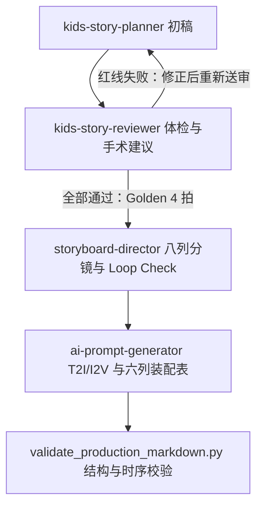

# 叙事工坊

叙事创作 Skill 的开发仓库，当前插件版本为 `0.2.0-draft`，包含 `kids-story-planner`（少儿双语动画·爆款故事策划师）、`kids-story-reviewer`（少儿双语动画·剧本医生）、`storyboard-director`（少儿双语动画·分镜导演）和 `ai-prompt-generator`（AI 提示词与制作清单编译器）。四个 Skill 按门禁顺序交接，共用物理、时间与提示词约束。

## 当前能力

`kids-story-planner` 为 2–6 岁儿童策划双语英语启蒙短视频，根据教学词汇匹配八大反差戏剧母题。`auto` 自动选择节奏，`rapid` 为 10–15 秒两拍，`standard` 为 15–25 秒三至四拍。

每条故事最多一个场景、两个角色、一个核心道具。输出规格设定、选定母题、教学与 TPR 映射、动态节拍和家长 CTA；策划说明用中文，成片采用英文原声与轻量中文词义字幕。单教学事件绑定一个目标词，同一 Beat 可先后对比；词义有可观察的动作、状态或关系映射，静态示范有效。承力写清接触位置、施力方向与承力方式，掌心承托、环抱、一体凹槽等按实际动作选择，不强制光滑道具加凹痕。未封闭气动/流体道具写清主手外缘抓握、副手临时封口与释放因果；双角色各至少一句台词，全片有一处情绪感叹词，母题动作次数与 Beat 正文逐项一致。产出仅为故事策划，不划分镜头、不生成媒体 Prompt 或图片/视频。

`kids-story-reviewer` 是 planner 与 director 之间的强制门禁。它接收完整五栏目策划稿，检查 `VOCAB_GROUNDING_MISMATCH`、`UNCLOSED_AIRBORNE_ACTION`、`TEACHING_POLLUTION_AT_END` 和 `MAGIC_RESET` 四个红线，并从道具玩具化、黏土身体喜剧、教学无歧义、四拍递进因果四维提出手术建议。只有严格输出 `- **红线筛查**：全部通过` 时，才生成含五个同名三级栏目和连续四拍的 Golden 润色稿；失败报告不会流入导演。

`storyboard-director` 只接收通过 reviewer 门禁的 Golden 4 拍大纲，保持故事逻辑与资产预算，将节拍拆成秒级视听分镜。极速版使用 3–4 镜，标准版使用 4–6 镜、必要时允许 ±1 镜，每镜 2.5–4.5 秒。仅输出导演总览、8 列分镜表和首尾循环验证，包含三段式黏土动力学、英文原声、玩具拟声音效与同步英文花字；不生成媒体 Prompt、工具参数或图片/视频。

`ai-prompt-generator` 严格接收导演总览、8 列秒级分镜表和首尾循环验证，编译为三个固定栏目：全局一致性资产卡、逐镜 T2I 故事板起始帧与 I2V 动态驱动矩阵、后期音画装配清单。采用 Preset + Adapter：Pip、Toby 与 Cozy Playroom 使用内置黄金锚点，自定义角色、场景和道具保留身份与剧情功能并适配为统一黏土风格；继承一个场景、最多两个角色、最多一个核心道具的预算，保留上游剧情与时序。仅对常规旧 Pan 提供有限的 Static 规范化：原固定取景必须能覆盖完整动作，并同步提示词与控制字段，否则要求上游修正。

构图、T2I 与 I2V 显式声明角色中心、道具中心和脚底基线等起始坐标，按上游空间关系填写，零道具不补物件；数值锚点不冻结后续回位轨迹。T2I 只描述 t=0 的静态切片、地面支点与接触阴影，完整复用实际入镜角色的资产卡锚点，仅允许大小写与空白规范化。Pip/Toby 的内置卡核对各自预设，自定义角色复用自己的 `[Dynamic Clay-Adapted Anchor]`，不强加内置角色特征。全局资产卡与每条 T2I 固定加入暖粉彩、3200K studio warm lighting 和 consistent clay material index。双角色入镜的 I2V 用 while 描述副角色在场微动，Hold 明确 aftermotion decays；依赖开口泄压的道具禁止永久封闭描述。每镜通用负向词放入代码块之外的独立 `Negative Prompt:` 字段；`Motion Strength:`、`Camera Mode:`、`Start-Frame:`、`End-Frame:` 也分别单列，台词、SFX 与英文花字进入后期六列表格，单次花字/字幕生命周期合并在触发行，独立声音与镜尾检查仍保留。

`Reference Asset:` 标明首镜起始关键帧作为角色与风格参考、上一镜实际生成的尾帧作为连续性参考；未生成资产标记待生成。末镜保留物理复位过程，在提示词代码块之外分别声明 `Keyframe Control: First-Last Frame Mode` 与 `End-Frame: Shot 1 Start Keyframe`，并完整沿用导演 Loop Check 的首尾状态 JSON；字段、单位和完整示例见 [状态契约](plugins/narrative-studio/skills/storyboard-director/references/loop-state.md)。比较首镜首帧与末镜尾帧的位置、朝向、姿态、接触、速度、动作相位、次级微动、道具及视图状态；允许末镜起点不同及匹配的非零运动。

导演阶段可补充目标平台：Douyin 仅为核心教学词加轻量中文词义；TikTok、YouTube Shorts 及平台缺省时使用英文花字，可配英文字幕。编译器沿用该字幕策略。四个 Skill 按“故事策划 → 剧本审查门禁 → 秒级分镜 → 提示词与后期装配”分别手动调用，不自动调用下游技能；全部只生成文字，不直接调用外部绘图或视频模型 API，也不生成图片或视频。



## 一致性与时间约束

- 每镜首帧与整个 Hold，所有角色均有地面支点。被动冲击优先贴地滑行或单脚后仰；教学语义确需的跳跃须在同镜爆发段完成起落与缓冲，滞空 ≤1.0 秒。
- 默认 Static，首末镜固定为中全景 / Static 且取景对齐，默认禁用常规 Pan/Tilt；中间升级镜最多一次单向微推，终点 ≤1.1×。跟随仅适用于既有、语义确需的单角色大范围位移。道具几何中心全过程保持在画面宽度 35%–65%，膨胀轮廓可以超出。
- 花字只承载核心教学词，弹出即完整可读，保持 1.2–1.5 秒，退场固定 0.5 秒；满足 `T_trigger + T_text_hold + 0.5s ≤ T_shot`，其中 `T_text_hold` 不等于动力学 Hold。前字完全消失至后字触发间隔 ≥0.5 秒，使用全片绝对时间检查镜内、跨镜和循环拼接处。末镜触发 ≤单镜时长−3.0 秒，完全消失 ≤单镜时长−1.25 秒，镜尾至少 1.25 秒无花字、无字幕。
- 感叹词只作原声，不生成自己的花字或字幕，发音与教学词错峰，优先使用清屏窗口。若原声发生在教学花字保持期间，已有花字仍按完整生命周期退场，不为感叹词提前清字。
- 声音按台词/主要 SFX 实际区间的并集审计：一般前景空白 ≤1.5 秒，高潮空白 ≤2.0 秒；持续声明区间内禁止重复触发，环境微声不计入前景覆盖，跨镜空白连续计算。缺少区间或生命周期时，编译器要求补充导演稿。

## 本地工业化校验

策划与 reviewer 共享 `VOCAB_GROUNDING_MISMATCH`、`UNCLOSED_AIRBORNE_ACTION`、`TEACHING_POLLUTION_AT_END`、`MAGIC_RESET` 四个红线词典；策划另有 `ACTION_COUNT_MISMATCH`、`DIALOGUE_QUOTA_ZERO`，编译器聚焦 `ANCHOR_MISSING`、`PROCESS_VERB_IN_T2I`、`LOOP_STATE_MISMATCH`，同时保留上游输入检查。完整 Golden 双文件位于 `tests/fixtures/industrial-upgrade/`，reviewer 契约夹具位于 `tests/fixtures/story-reviewer/`。负例尽量只破坏一个条件；原始三模型样稿与旧执行记录不自动视为新版合格产物。

在仓库根目录执行：

```bash
python3 plugins/narrative-studio/skills/storyboard-director/scripts/validate_production_markdown.py tests/fixtures/industrial-upgrade/golden-director.md tests/fixtures/industrial-upgrade/golden-prompts.md
python3 -m unittest discover -s tests -p 'test_*.py' -v
```

校验器只依赖 Python 标准库，输入为导演八列表 Markdown 和可选制作矩阵 Markdown。导演稿须按模板声明出场角色、高潮 Beat、每镜首帧/Hold支点，以及 `跳跃声明：无` 或完整起跳/落地/缓冲秒点；Loop Check 必须含首尾状态 JSON。制作矩阵可声明每镜入镜角色，缺省按全片名单检查，单角色入镜无需补人或 while。花字使用标准单行生命周期，声音使用明确起止区间。配套字幕可在花字行末写 `；字幕：High/高处（与花字同生命周期）`。缺少可解析证据报 `INPUT_FORMAT`。

跳跃超出爆发段、缓冲进入 Hold 或滞空超过一秒报 `ZERO_AIRBORNE_CUT`，漏报肯定性跳跃报 `UNDECLARED_JUMP_ACTION`；花字安全期不足报 `TEXT_OVERLAP` 并定位前后镜号与绝对秒点；镜头/阶段/音画越界报 `SHOT_TIME_OVERFLOW`。状态缺项报 `INPUT_FORMAT`，首尾或导演/编译声明不一致报 `LOOP_STATE_MISMATCH`。错误返回非零退出码。可选矩阵继续核验坐标、Palette Lock、开口道具、双角色保活、控制字段及后期花字生命周期。

动作检测是有限词表与分句规则扫描，不是自然语言 AST。跳跃扫描排除常见否定句、引用教学词和角色名称。T2I 扫描 falling、bouncing、dropping、deflating、escaping、descending、stepping away、flying，允许静态 holding、leaning、standing、resting 及身份词组 flying squirrel。通过仅证明结构、时序和显式声明一致性；自由文本物理因果与最终生成媒体仍需复核。

Reviewer 的强门禁由 Skill 输入输出契约执行，`tests/test_story_reviewer.py` 用手写夹具核验状态行、三栏顺序、五个 H3 和四拍结构；它不自动运行 LLM，不是另一个生产语义校验器。现有生产脚本继续只接收导演稿和可选制作矩阵，红线含义与幽默质量由 reviewer 评审。

## 本地验证包

`artifacts/` 保存既有工业化升级的基线和 `0.2.0-draft` 验证快照，本次未重打包，因此不含新增 reviewer 与本次门禁改动。文件名附内容哈希前缀，两包均包含当时的插件、测试和 README；内部 `SHA256SUMS` 逐文件列出 SHA-256，`SNAPSHOT.json` 记录源提交、实际插件版本和完整内容哈希。内容哈希由排序后的文件名/哈希映射计算，不因版本号相同而推断内容相同；归档旁的 `.zip.sha256` 校验整个 ZIP。

先在归档目录执行 `shasum -a 256 -c 对应文件.zip.sha256`；解压后在根目录执行 `shasum -a 256 -c SHA256SUMS`，再运行上面的 unittest 与双文件 CLI。验证包可独立本地验收，本轮没有安装插件、修改本机缓存或发布版本。

## 安装与使用

四个 Skill 已实现，通过插件的 `"skills": "./skills/"` 入口自动发现。需要验收安装效果时，由你手动注册本地来源并安装：

```bash
codex plugin marketplace add /Users/a0000/project/ai-creation-studio
codex plugin add narrative-studio --marketplace ai-creation-studio
```

安装并加载技能后，在新对话中调用：

```text
$kids-story-planner
teaching_words: Jump
characters: 小恐龙 Pip、小柴犬 Toby
target_platform: YouTube Shorts
pacing_mode: auto
```

策划师只有 `teaching_words` 必需，其余参数可省略，也可以直接用自然语言提出请求。拿到完整策划后，在同一对话调用 reviewer，或在新对话粘贴完整上游输出：

```text
$kids-story-reviewer
以下是 kids-story-planner 的完整输出：
[粘贴规格设定、选定戏剧母题、教学与 TPR 映射、剧情节拍大纲及家长 CTA]
```

红线失败时，第三栏只给出拒绝下游稿和重新送审指引；将体检报告和手术建议交回 planner 重写，再次调用 reviewer。通过稿将原两/三/四拍统一为 Golden 4 拍，保留实际模式和总时长（rapid 10–15 秒、standard 15–25 秒）；四拍不等于四镜。

只有 reviewer 严格输出 `- **红线筛查**：全部通过` 和 Golden 4 拍时，才继续调用导演：

```text
$storyboard-director
target_platform: YouTube Shorts
以下是 kids-story-reviewer 的完整输出：
[粘贴剧本硬线与雷达体检、手术级打磨建议及重写润色后的 4 拍大纲]
```

导演仅接收通过 reviewer 门禁的完整输出，不能用原始 planner 大纲、红线失败报告或一句题材/教学词替代；缺失契约、标题漂移、超出预算或无法物理复位时，先要求补充或修正上游。拿到完整导演输出后，再调用编译器：

```text
$ai-prompt-generator
以下是 storyboard-director 的完整输出：
[粘贴导演总览、完整 8 列秒级分镜表、首尾无缝循环验证]
```

编译器不能用故事大纲替代导演输出，也不自行补写台词、音效、花字或时间点。输入缺项、对白配额不齐、接地/构图/时限冲突或循环无效时，先指出需要上游修正的内容。技能原文见 [故事策划师](plugins/narrative-studio/skills/kids-story-planner/SKILL.md)、[剧本医生](plugins/narrative-studio/skills/kids-story-reviewer/SKILL.md)、[分镜导演](plugins/narrative-studio/skills/storyboard-director/SKILL.md) 与 [提示词编译器](plugins/narrative-studio/skills/ai-prompt-generator/SKILL.md)，验收场景及历史执行记录见 [验收记录](tests/acceptance-cases.md)。

## 仓库结构

- `plugins/narrative-studio/`：插件清单与四个独立 Skill。
- `.agents/plugins/marketplace.json`：本地插件来源清单。
- `migration-archive/`：保留的迁移记录，不作为当前实现。
- `tests/acceptance-cases.md`：四个 Skill 的当前验收口径与历史记录；`tests/fixtures/industrial-upgrade/`、`tests/fixtures/story-reviewer/`、`tests/test_industrial_validator.py`、`tests/test_story_reviewer.py`：正反例与自动回归测试。
